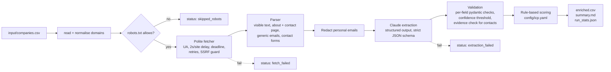

# Company lead enrichment pipeline

Turns a plain list of company websites into a scored lead list a small sales team can act on:
industry, short description, size signal, location, products/services, and a verified public
business contact channel, each with a confidence score, plus a transparent fit score with the
reason for every point.

Portfolio case study (see [CASE_STUDY.md](CASE_STUDY.md)). Demo scenario: a small agency selling
bookkeeping software to local businesses around Bristol, UK.

**Public business information only.** No personal data is collected; see
[Compliance](#compliance-gdpr-aware-design).

## What you get

`enrich run input/companies.csv` writes three files to `output/`:

| File | Contents |
|---|---|
| `enriched.csv` | One row per company, best leads first: tier, score, `score_reasons`, extracted fields, per-field confidence, `flags` for anything rejected, `insecure_transport` (some pages only reachable over plain HTTP), pages used |
| `summary.md` | Status and tier counts, top-10 table, "needs attention" list, measured run metrics |
| `run_stats.json` | Machine-readable metrics: time, HTTP requests, cache hits, tokens, cost |

Example from the mock demo run (full files in [`examples/demo-mock/`](examples/demo-mock/)):

| # | Company | Tier | Score | Why |
|---|---|---|---|---|
| 1 | Avon Valley Plumbing & Heating | A | 95 | industry construction_and_trades (+25); size 2-10 (+30); in target area (Bristol) (+25); verified business contact channel (+10); keywords: quotes (+5) |
| 4 | Redcliffe Books & Coffee | A | 85 | industry retail (+20); size 2-10 (+30); in target area (Bristol) (+25); keywords: deliveries, online shop (+10). Flag: `contact_email:personal_email_rejected`, so the contact is left blank |
| 10 | Ledger & Co Accountants | C | 25 | industry accounting_and_finance (-40); size 2-10 (+30); in target area (Bristol) (+25); verified business contact channel (+10) |

## Architecture



| Module | Responsibility |
|---|---|
| `fetcher.py` | Robots check per origin (also on each redirect hop), per-site rate limit, timeouts, retries with backoff for timeouts/429/5xx, `Retry-After`, SSRF guard, body deadline and byte cap, robots.txt cache. Transport is swappable: live (`requests`) or saved HTML fixtures. |
| `robots.py` | RFC 9309 semantics: 2xx obey, 4xx allow, 5xx/network error disallow everything. Rule matching by [protego](https://github.com/scrapy/protego) (longest match, `*` and `$`). `Crawl-delay` honoured. |
| `parser.py` | Visible text, about/contact page discovery (people/team/careers pages excluded), role-based email detection, personal email redaction, contact-form detection. |
| `extractors.py` | `ClaudeExtractor` (Anthropic SDK, structured outputs, token usage and cost, LLM response cache) and `MockExtractor` (saved fixtures). |
| `schema.py` | The JSON schema sent to the model and field-by-field validation that flags instead of guessing. |
| `scoring.py` | YAML-configured ideal customer profile, one reason per rule, tiers. |
| `pipeline.py`, `report.py`, `cli.py` | Orchestration, outputs, command line. |

Design decisions with alternatives considered are in [DECISIONS.md](DECISIONS.md).

## Quickstart

Requires Python 3.11+.

```bash
python -m venv .venv && source .venv/bin/activate
pip install -e ".[dev]"

# 1. Offline demo: saved HTML for 13 invented companies + mock LLM answers. No key, no network.
MOCK_LLM=1 enrich run input/companies.csv --html-fixtures fixtures/sites

# 2. See the plan and a cost estimate without fetching or calling anything
enrich run input/companies.csv --dry-run

# 3. Real LLM on the saved demo pages (measures real extraction cost on fixed input)
cp .env.example .env   # then put your ANTHROPIC_API_KEY in .env
enrich run input/companies.csv --html-fixtures fixtures/sites

# 4. Fully live: your own list of real public business websites
enrich run my_companies.csv

# Tests (offline)
python -m pytest
```

Input CSV: a header row with a website column (`website`, `domain` or `url`) and optionally a
name column (`company_name`, `company` or `name`). Domains are normalised
(`https://www.Foo.com/about` becomes `foo.com`); duplicates and blank rows are skipped with a
warning.

CLI options: `--config`, `--icp`, `--output-dir`, `--html-fixtures DIR`, `--limit N`,
`--no-cache`, `--dry-run`. Exit code is 1 if no company could be enriched.

## Configuration

| Where | What |
|---|---|
| `config/settings.yaml` | User-Agent, timeouts, retries, per-site delay, pages per company, cache dirs and TTL, model, `max_tokens`, input size cap, token prices, confidence threshold |
| `config/icp.yaml` | Scoring: points per industry and size bucket, target cities/countries, contact-channel bonus, keywords, tier thresholds, minimum known core fields |
| `.env` (git-ignored) | `ANTHROPIC_API_KEY`, optional `ENRICH_MODEL`, `MOCK_LLM` |

Default model: `claude-haiku-4-5-20251001` (override with `ENRICH_MODEL` or `llm.model`). Token
prices in `settings.yaml` are used for the cost report only; check current pricing before
quoting numbers.

Fields below `validation.min_confidence` (default 0.6) are blanked and listed in `flags`, for
example `size_signal:low_confidence(0.40)`. Other flags: `invalid_value`,
`personal_email_rejected`, `off_domain_email` (not on the company's domain or a subdomain),
`not_found_in_source` (email not on the pages), `off_site_url`,
`no_form_found_at_url`, `insecure_source` (seen only on a page fetched over plain HTTP),
`invalid_country_code`, `too_long`, `missing_from_output`.

## Compliance (GDPR-aware design)

- **Only public business information.** The schema has no field that can hold a person. Only
  role-based mailboxes (`info@`, `hello@`, `contact@` ... fixed allowlist) on the company's own
  domain (or a subdomain) or a contact form URL are output, and only if they literally appear on
  the company's own pages.
- **Data minimisation before processing.** Every non-role email address is replaced with
  `[personal email removed]` before page text is sent to the LLM or cached. This includes
  plus-addressed role boxes (`sales+jane.smith@`), internationalised addresses (`jane@müller.de`)
  and common obfuscations (`jane [at] shop [dot] example`, `jane(at)shop(dot)de`,
  `jane at shop dot com`). Team, staff, people and careers
  pages are never fetched. At most 3 pages per company.
- **Respect for site owners.** robots.txt is always obeyed (no off switch), the User-Agent names
  the bot and links to this repo, at least 2 s between requests per site, `Crawl-delay` and
  `Retry-After` honoured, sites asking for more than 60 s delay are skipped, pages cached for a
  week so re-runs do not re-hit sites. Check each site's terms of use before running on it.
- **What is stored on disk.** Raw HTML is never written to disk. The page cache
  (`cache/http`, one-week TTL) holds only the *parsed* page: visible text with personal emails
  already removed, title, links and role mailboxes; plus robots.txt files. The LLM cache
  (`cache/llm`) holds the model's JSON answers. Cache folders are created owner-only (`0700`,
  files `0600`). Names in running text can still be in the cached text (see Limitations);
  delete `cache/` to erase everything, e.g. after a run or on an objection.
- **No secrets in the repo.** Keys come from the environment or a git-ignored `.env`;
  `.env.example` is the only env file committed.
- **Your responsibilities as the operator:** you are the controller for whatever you do with the
  output. Have a lawful basis (typically legitimate interest for B2B prospecting, with a balancing
  test), honour objections, and follow your country's rules for B2B email marketing (e.g. PECR in
  the UK). This tool is not legal advice.

## Security

Every website, header and model answer is treated as untrusted input.

- **No SSRF.** Before every request (pages, robots.txt, each redirect hop, each retry) the host
  is resolved and the request is refused unless *every* address is globally routable unicast
  (`ipaddress.is_global`, with IPv4-mapped, 6to4 and NAT64 forms judged by the embedded IPv4
  address). Only `http`/`https` URLs are followed. IP-literal hosts in the input CSV are rejected.
- **One bad site cannot stall or crash the batch.** Each response body is read against a byte
  cap (after decompression, so gzip bombs are capped too) and an overall deadline
  (`fetch.deadline_seconds`, default 20 s), not just a per-read timeout. Unknown charsets fall
  back to UTF-8. Only plain `Retry-After: <seconds>` values are honoured. Any unexpected error
  marks that company `internal_error` and the run continues.
- **Plain HTTP is not trusted for contact data.** If HTTPS fails and a site is read over plain
  HTTP (fallback), the row is marked `insecure_transport` and no contact email or form URL from
  those pages is accepted (`insecure_source` flag): it could have been altered in transit. If a run is interrupted (Ctrl-C) or
  stopped by a configuration error, the companies already finished are still written out.
- **No Slack or Markdown injection.** Every field in `summary.md` (company names, errors, model
  output, config text) is escaped: `&`, `<`, `>` (so no `<!channel>` or `<url|label>` in Slack),
  backticks, brackets and pipes. Error messages carry only a validated media type, never raw
  header text. CSV cells starting with `= + - @` are prefixed with `'` (formula injection).

## Limitations

- **Names in free text are not redacted.** "Email Priya at ..." loses the address but keeps
  "Priya" in the text sent to the LLM. Mitigated (no person fields, prompt forbids names, tests
  check outputs), not eliminated. See DECISIONS.md.
- **DNS rebinding is not fully closed.** The SSRF check resolves the host, then `requests`
  resolves it again to connect. A hostile DNS server could answer with a public address the
  first time and a private one the second. Closing this needs connecting to the checked IP
  (custom transport adapter with SNI/Host handling); not done in the MVP. Run the tool on a
  machine without access to sensitive internal services if you crawl untrusted lists.
- **Size is a signal, not a headcount.** It comes from what the site says ("team of eight").
  Many small sites say nothing, so `size_signal` is often blank.
- **No JavaScript rendering.** Sites that render content client-side yield little text and land
  in tier `review` or `extraction_failed`.
- **Sequential and polite means slow on live sites:** about 3 pages x 2 s per company plus LLM
  latency. Fine for tens to low hundreds of companies, not for tens of thousands.
- **Keyword points are self-reported.** They come from the company's own website text (via the
  description and products the model extracts), so a site can inflate its own tier by stuffing
  words like "invoicing" or "wholesale". The keyword bonus is capped (`keywords.max_points`).
- **Scoring weights are a starting point** written for the demo scenario, not validated against
  real conversion data.
- **Demo data is invented.** The 13 companies, their websites and the mock LLM answers were written
  by hand for this repo (on reserved `.example` domains). Mock answers include deliberately bad
  fields to exercise validation. They are not real model outputs.
- **Real mode was not run.** No API key was available for this project, so the Claude API was
  never actually called: every demo result comes from hand-written mock answers. The real-mode
  code path is tested only against a fake client. AI cost and latency figures are **estimates**
  (dry-run formula and an assumed latency), and extraction quality (how accurately Claude fills
  each field) is **not measured**. The validation results show that bad fields are caught, not
  how often a real model produces them. See CASE_STUDY.md.

## Automation (optional)

[`n8n/enrich-weekly.json`](n8n/enrich-weekly.json) is an n8n workflow that runs the CLI every
Monday morning and posts `summary.md` to a Slack channel. See [`n8n/README.md`](n8n/README.md).

## Project files

- [PROGRESS.md](PROGRESS.md): phased task list and current state
- [DECISIONS.md](DECISIONS.md): architecture and security decisions
- [BUILD_LOG.md](BUILD_LOG.md): build notes, problems hit, measured numbers
- [CASE_STUDY.md](CASE_STUDY.md): problem, approach, results
